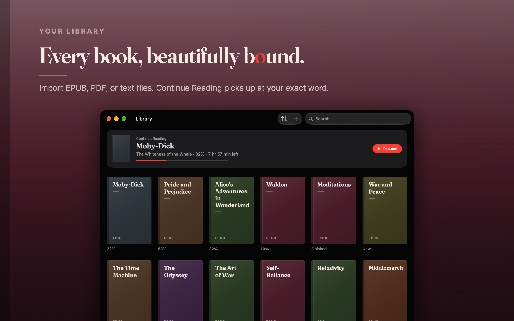

<p align="center">
  
</p>

<h1 align="center">Read more. Move less.</h1>

<p align="center">
  <b>Strobe</b> is a free, open-source speed reader for iPhone, iPad, and Mac.
  Read books, papers, and articles one word at a time, with adjustable speed,
  word timing, a searchable full-text view, and a natural voice that can read
  along.
</p>

<p align="center">
  <a href="https://apps.apple.com/us/app/strobe-speed-reading/id6759187873">
    
  </a>
</p>

<p align="center">
  <a href="https://strobefast.app">
    
  </a>
  <a href="https://github.com/abdeen-labs/rapid-serial-visual-presentation/actions/workflows/tests.yml">
    
  </a>
  <a href="LICENSE">
    
  </a>
  
</p>

<p align="center">
  
  
  
  
</p>

## How it works

Strobe uses **Rapid Serial Visual Presentation (RSVP)** to display words in sequence. Each word aligns on a highlighted letter, called the **Optimal Recognition Point**, at a fixed position on the screen.

Set the pace from **100 to 1,000 words per minute** and adjust it while you read. The pace you set is how fast you read overall: pauses and slowdowns take their time from the other words, so the time left is the time it takes.

## Built for focused reading

### Hold to read. Let go to pause.

Press and hold anywhere on the screen to read, and lift your finger to stop. Slide up or down mid-sentence to change speed on the fly, and swipe sideways to step word by word. Prefer hands-free? Tap with two fingers and reading carries on until you tap again, or turn off Hold to Read and tap to play instead.

### Adjustable word timing

Add time for long words and choose pause lengths for sentence ends, commas, dashes, ellipses, and closing quotes. Acronyms and hyphenated compounds receive extra time automatically. Complexity Timing speeds up simple words and slows down complex ones, with a slider for each. You can also add a blank interval between sentences.

### Listen as you read.

Turn on Read Aloud and a natural voice reads along as the words show, at up to 450 words per minute, in any of 15 American and British English voices. The voice downloads once, about 160 MB, then runs on your device and works offline. On a Mac, and on iOS 27 and later, it reads on while you use other apps or lock the screen, and plays and pauses from Now Playing and your headphones. Reading aloud is for English documents, on every Mac and on iPhones and iPads with about 4 GB of memory or more.

### Context and chapter titles

Show the previous word, the next, or both beside the one you're reading, as faint as you like while words play, and see an open quote or parenthesis hover above until it closes. Each new chapter shows its title as you reach it.

### The whole page, one tap away.

Open the full text with your place highlighted. Search for any word or phrase, jump between matches, and tap any word to pick up reading from there.

### Fonts and colors

Choose from seven typefaces, including Fraunces and JetBrains Mono, with adjustable text size. Four text colors (Bright, Soft, Sepia, and Night) tone down the word, seven highlight colors mark its focus letter, and a true black background is made for reading in the dark. Turn on Pop Words In and each word springs in like video captions. The reader has its own Settings button, so you can change all of it without leaving the book. Every document remembers its own speed.

### Know how you read.

Strobe keeps track of your reading: time and words read, your average session, and your real speed, by week, month, year, or all time, with the voice and without. Open Statistics from the library's toolbar.

### Made for the keyboard.

On a Mac, or an iPad with a keyboard: <kbd>Space</kbd> reads and pauses, <kbd>←</kbd> <kbd>→</kbd> step through words, <kbd>Esc</kbd> goes back, <kbd>⌘N</kbd> starts a new text, and <kbd>⌘O</kbd> imports a file.

## Bring what you already read

<p align="center">
  
</p>

Import EPUB, PDF, plain-text, and Markdown files from Files or with drag and drop, a whole batch at once, or paste in an article and see its word count and reading time before you start. Every book gets its own cover, the one you're reading waits at the top, and Strobe picks up at your exact word.

- **Share from anywhere.** Share an article from Safari, a link, or selected text from any app to Strobe, and it's waiting in your library without the page's menus and ads.
- **Chapters at a glance.** EPUB tables of contents and PDF bookmarks become chapters, each with its reading time at your speed.
- **Clean text.** Page numbers, running headers, and footers are stripped on import.
- **Not just English.** Chinese, Japanese, and Korean text is split into words automatically, and Arabic keeps its connected letterforms.

DRM-protected EPUBs and password-protected PDFs can't be imported.

## Wherever you read

- **iCloud Sync.** Your library, reading positions, and reading statistics follow you across iPhone, iPad, and Mac. If the same book turns up twice with slightly different text, Strobe points it out and lets you keep one copy or both.
- **Continue Reading widget.** The book you're on, on the Home Screen, the Lock Screen, or the Mac desktop, one tap from your place.
- **Siri and Shortcuts.** Say "Continue reading in Strobe", "Open Moby-Dick in Strobe", or "How far am I in Strobe". The Speed Read Text action sends text from any shortcut to the reader.
- **iPhone Duo.** Read on the outer screen, then open it up and keep going from the same word. Open, the book page spreads across both sides of the fold.

<p align="center">
  
</p>

## Private by design

Strobe processes documents and stores your library on your device. With iCloud Sync on, your library and reading history also go to your own private iCloud database, never to a server of ours. The voice runs on your device too: after its one download, nothing you read leaves it to be spoken. Strobe requires no account and includes no ads or analytics.

## Free and open source

Strobe is free, with no subscription or in-app purchases. The source is available under the Apache 2.0 license. If it earns a place in your reading routine, you can [support development on Buy Me a Coffee](https://buymeacoffee.com/cuzeth) or give the repo a star.

---

## Under the hood

Strobe is SwiftUI and SwiftData, with one package: [FluidAudio](https://github.com/FluidInference/FluidAudio), which runs the voice on Core ML.

- **Import:** EPUBs are unzipped and read from their package manifest, with chapters from nested tables of contents and a DRM check up front. PDFs bring their bookmarks along.
- **Sharing:** a Share extension reads the article out of the Safari page you're on, or loads a shared link in an offscreen web view, and hands the text to the app through an App Group.
- **Tokenizer:** rejoins words hyphenated across line breaks, splits words joined by em dashes, keeps `10:30 PM` and `44 B.C.` in one piece, and segments CJK text with `NLTokenizer`.
- **Timing:** word length, punctuation, acronyms, compounds, and per-word complexity scores (computed once at import with the NaturalLanguage framework) all shape how long each word stays up. Each document's pace is worked out from its own words, so the speed you set is the speed you read.
- **Reading aloud:** the Kokoro-82M model (Apache 2.0) speaks a sentence at a time, rendered ahead, and each word shows when the model's predicted durations say it's heard. Faster speeds render faster speech, then stretch it.
- **Sync:** `CKSyncEngine` beside SwiftData, with each book and its reading state in separate records, so reading never re-sends a book. A ledger of what iCloud last confirmed keeps sync from deleting a book you didn't delete.
- **Widget and Siri:** the widget reads a snapshot of the book you're on from the App Group, and App Intents run inside the app, so what they change reaches the library and sync.
- **Tests:** 1,100+ Swift Testing cases, run on an iOS simulator and on macOS in CI.

```
Strobe/          The app: App, Engine, Import, Intents, Models, Speech, Sync, Views, …
StrobeShare/     Share extension
StrobeWidget/    Continue Reading widget
StrobeTests/     Swift Testing suites, one file per feature
Promo/           The video ad and the App Store image compositors
AppStore/        Screenshots and creative assets for App Store Connect
Scripts/         Build-phase scripts
```

## Build it yourself

1. Open `Strobe.xcodeproj` in Xcode 27. Xcode fetches the one package, FluidAudio, pinned to 0.17.7.
2. Pick the **Strobe** scheme and an iPhone, iPad, or Mac to run on.
3. To run on your own device or Mac, choose your team under **Signing & Capabilities** for the **Strobe**, **StrobeShare**, and **StrobeWidgetExtension** targets. Bundle IDs, App Group IDs, and iCloud containers are unique across teams, so also give the targets bundle IDs of your own, replace `group.com.abdeen.strobe` in `SharedContainer.swift` and the three `.entitlements` files, and replace `iCloud.com.abdeen.strobe` in `CloudRecords.swift` and `Strobe.entitlements`.

There are no API keys to add. The voice isn't in the repo: the app downloads it from Hugging Face when you first turn on Read Aloud. The iPhone Duo's fold needs the iOS 27.1 SDK; with the iOS 27.0 SDK, everything else builds.

To run the tests, press <kbd>⌘U</kbd> with the **Strobe** scheme on an iPhone simulator or your Mac, or from the command line:

```bash
xcodebuild test -project Strobe.xcodeproj -scheme Strobe -destination 'platform=iOS Simulator,name=iPhone 18 Pro'
```

## Contributing

Issues and pull requests are welcome. Keep changes focused, include tests when you can, and run the test suite before opening a PR. CI runs it on an iPhone simulator and on macOS for every pull request that touches the app, its extensions, the tests, or the project. A new package, font, or downloaded model needs its credit in `Strobe/Models/Acknowledgements.swift`.

## License

Licensed under the [Apache License, Version 2.0](LICENSE). The fonts, FluidAudio, and the Kokoro voice model keep their own licenses: see [Third-Party Notices](THIRD_PARTY_NOTICES.md), or Settings ▸ About ▸ Acknowledgements in the app.
